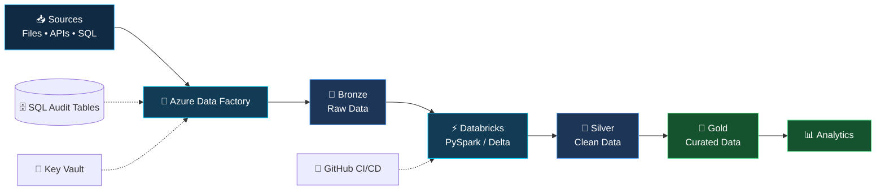

<!-- ====================================================== -->
<!-- SHIV BHADOURIA | DATA ENGINEER PROFILE                 -->
<!-- ====================================================== -->

  

 

---

## ⚡ DATA ENGINEERING CAPABILITIES

<table>
<tr>
<td width="50%" valign="top">

### 🔄 Data Pipeline Engineering

- Metadata-driven ingestion
- ETL/ELT pipeline development
- Full and incremental loads
- Watermark-based processing
- Pipeline parameterization
- Error handling and retries

</td>
<td width="50%" valign="top">

### ⚙️ Distributed Data Processing

- Python and PySpark transformations
- SQL joins and aggregations
- Deduplication and data validation
- Incremental MERGE operations
- Spark partitioning concepts
- Data processing optimization

</td>
</tr>
<tr>
<td width="50%" valign="top">

### 🏗️ Data Architecture

- Bronze, Silver and Gold layers
- Medallion architecture
- Data lake organization
- Analytics-ready datasets
- Data warehousing fundamentals
- Relational data modeling

</td>
<td width="50%" valign="top">

### 🔐 Production Engineering

- Pipeline control and audit tables
- Secret management with Key Vault
- Git-based version control
- CI/CD workflows
- Pipeline monitoring and logging
- Data quality and reliability

</td>
</tr>
</table>

---

## 🧰 TECHNOLOGY STACK

### ☁️ Cloud & Data Platforms

### 💻 Programming & Databases

### 🔧 Tools & Engineering Workflow

### 🌱 Currently Exploring

---

## 🏗️ DATA PIPELINE ARCHITECTURE

<i>Ingest → Transform → Validate → Curate → Deliver</i>

---

## 🏢 ENGINEERING EXPERIENCE & PRACTICAL CAPABILITIES

<table>
<tr>
<th>Area</th>
<th>Technical capabilities</th>
</tr>
<tr>
<td>📥 Ingestion</td>
<td>Azure Data Factory pipelines, parameterized datasets, source-to-target processing and incremental loading</td>
</tr>
<tr>
<td>⚡ Transformation</td>
<td>Python, PySpark, SQL joins, aggregations, deduplication and MERGE patterns</td>
</tr>
<tr>
<td>🗄️ Storage</td>
<td>Azure Data Lake concepts, Delta Lake, relational databases and medallion architecture</td>
</tr>
<tr>
<td>🔎 Reliability</td>
<td>Control tables, audit logging, pipeline monitoring, error handling and data validation</td>
</tr>
<tr>
<td>🚀 Delivery</td>
<td>Git, GitHub, CI/CD workflows, deployment practices and maintainable pipeline design</td>
</tr>
</table>

<i>Practical data engineering capabilities spanning ingestion, transformation, orchestration, storage and delivery.</i>

---

## 📈 GITHUB CONTRIBUTION UNIVERSE

<i>Real contribution history. A snake that follows the contribution calendar.</i>

<!-- Real GitHub contribution heatmap -->

 

<!-- Automatically generated animated snake -->
<picture>
  <source media="(prefers-color-scheme: dark)" srcset="https://raw.githubusercontent.com/shivbhadouria/shivbhadouria/output/github-contribution-grid-snake-dark.svg"/>
  <source media="(prefers-color-scheme: light)" srcset="https://raw.githubusercontent.com/shivbhadouria/shivbhadouria/output/github-contribution-grid-snake.svg"/>
  
</picture>

  

---

## 📊 GITHUB ANALYTICS

---

## 🤝 LET'S CONNECT

  

<b>⚡ Engineering Data. Building Pipelines. Enabling Insights. ⚡</b>

