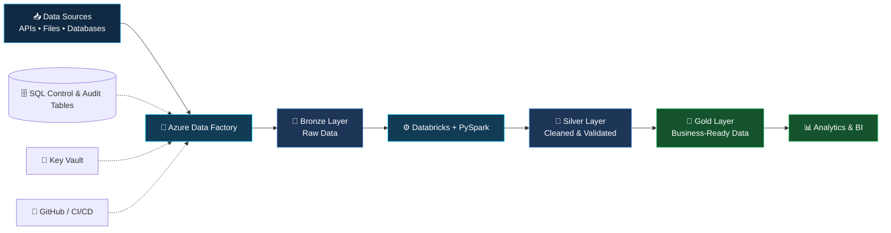

<!-- ===================== ANIMATED HEADER ===================== -->

 

  

---

<!-- ===================== CORE CAPABILITIES ===================== -->

<h2 align="center">⚡ DATA ENGINEERING CAPABILITIES</h2>

<table>
<tr>
<td align="center" width="33%">
 
<b>🔄 Data Pipelines</b>  
ETL/ELT • Metadata-driven ingestion • Incremental loads • Full loads
</td>
<td align="center" width="33%">
 
<b>⚙️ Data Processing</b>  
PySpark • SQL • Transformations • Deduplication • Data quality
</td>
<td align="center" width="33%">
 
<b>☁️ Cloud Data Platforms</b>  
Azure Data Factory • Databricks • Data Lake • Azure SQL
</td>
</tr>
<tr>
<td align="center">
 
<b>🏗️ Data Architecture</b>  
Medallion architecture • Bronze/Silver/Gold • Data warehousing
</td>
<td align="center">
 
<b>🔐 Reliability & Governance</b>  
Audit tables • Secret management • Pipeline monitoring • Data validation
</td>
<td align="center">
 
<b>🚀 Engineering Workflow</b>  
Git • GitHub • CI/CD concepts • Debugging • Automation
</td>
</tr>
</table>

---

<!-- ===================== LIVE DATA PIPELINE ===================== -->

<h2 align="center">🌐 DATA PIPELINE ARCHITECTURE</h2>

<i>From source ingestion to trusted, analytics-ready data.</i>

---

<!-- ===================== TECH STACK ===================== -->

<h2 align="center">🧰 TECHNOLOGY ARSENAL</h2>

<h3 align="center">☁️ Cloud & Data Engineering</h3>

<h3 align="center">💻 Programming & Databases</h3>

<h3 align="center">🔧 Engineering Practices</h3>

---

<!-- ===================== ENTERPRISE CAPABILITIES ===================== -->

<h2 align="center">🏢 ENTERPRISE DATA ENGINEERING SKILLS</h2>

<table>
<tr>
<th>Domain</th>
<th>Capabilities</th>
</tr>
<tr>
<td>📥 Ingestion</td>
<td>Source-to-target ingestion, parameterized pipelines, metadata-driven configuration, full and incremental loads</td>
</tr>
<tr>
<td>⚡ Transformation</td>
<td>PySpark transformations, SQL joins, aggregations, deduplication, merge/upsert patterns</td>
</tr>
<tr>
<td>🗄️ Data Storage</td>
<td>Data lake organization, Delta Lake concepts, medallion architecture, relational data stores</td>
</tr>
<tr>
<td>🔍 Data Reliability</td>
<td>Audit logging, control tables, data validation, error handling, retry strategies, pipeline troubleshooting</td>
</tr>
<tr>
<td>🔐 Security</td>
<td>Secrets management concepts, access control, secure configuration, sensitive-data awareness</td>
</tr>
<tr>
<td>🚀 Delivery</td>
<td>Git-based version control, deployment workflows, CI/CD concepts, documentation and maintainability</td>
</tr>
</table>

<i>Technical capabilities aligned with enterprise data engineering workflows, including SQL and PySpark transformation, Azure ingestion pipelines, and incremental data processing.</i>

---

<!-- ===================== GITHUB ANALYTICS ===================== -->

<h2 align="center">📊 GITHUB ANALYTICS</h2>

 

---

<!-- ===================== LIVE GITHUB CONTRIBUTIONS ===================== -->

<h2 align="center">📈 LIVE GITHUB CONTRIBUTIONS</h2>

<!-- Official contribution graph from GitHub Readme Stats -->

  

---

<!-- ===================== LIVE ACTIVITY ===================== -->

<h3 align="center">⚡ RECENT GITHUB ACTIVITY</h3>

---

<!-- ===================== CONNECT ===================== -->

<h2 align="center">🤝 LET'S CONNECT</h2>

  

<b>⚡ Build Reliable Pipelines · Engineer Scalable Data · Deliver Insights ⚡</b>

